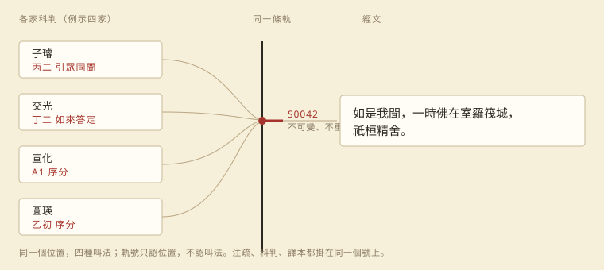

# 一句話，一個門牌

> 書同軌：從《楞嚴經》九家科判說起

一九九五年我開始把古籍搬進電腦，最常被問的是「這一句在第幾頁」。二十多年過去，我發現真正的問題不是頁，是**同一個位置在不同書裡叫不同的名字**。

《楞嚴經》正文三千七百三十二句。環繞它的科判，我們收了九家：子璿、交光、憨山、直指、靈耀、溥畹、宣化、圓瑛、蕅益。九家都在分同一部經，卻各有一套地址——子璿的「丙二」，交光的「丁二」，宣化的「A1」。九套地址擺在一起，第一個難題不是誰對，是怎麼把它們放到同一條線上。

我們的辦法很笨：先把經文攤成一條連續的句子流，每句一個號；再讓每一家的節點去指那個號。指得到的，叫實錨；指不到的，才在兩個錨之間按順序填。九家合起來，一萬一千零七個節點，落在兩千四百一十八個切點上。

為什麼不用頁行？因為頁行是版面的座標。換一個版本、換一次印刷，同一句話就換行、換欄；拿它做跨版本對齊，等於要求十幾份排版在同一個折頁上斷同樣的行。

然後看見兩件事。

第一，支持度不是真理。兩千四百一十八刀裡，一千二百九十二刀只有一家支持，一千零三十七刀兩家，三家以上只有八十九刀。如果按「多數決」砍，會把單家但精確的錨點全丟掉——子璿、宣化的實錨很多正是單家。

第二，節點會塌縮。交光有一千八百零三個節點疊在同一句，灌頂一千四百二十六，圓瑛一千一百二十六。那不是他分得粗，是那一段他整棵子樹都掛在同一個起點上。這種切點不能算數，演算法要看得出來。

所以「合」不是取聯集。聯集是最大切分，不是最小切分。最小切分要問：這一刀，是哪一家非有不可的邊界？少了它，那一家的節點就無處可放。答案通常比聯集少一半。

地址定了，其餘都好辦。注疏段落只記「從哪個號到哪個號」，不再各存一套頁行；科判只記「這個節點落在哪個號」；英譯、藏譯、梵文進來的時候，只增加軌號與對齊，不動漢文一個字。缺譯就標缺，節譯就標一對多——錯要錯得看得見。

好處很實在：一家注疏的同一個位置，可以直接 join 到另一家、再 join 到科判與譯本。查一家，等於查九家；新增第十家，只多一欄對映，主文一個字都不動。

## 人與機器共用一組號

這套地址最先受益的其實不是程式，是對話。

以前我跟機器說「楞嚴經講奢摩他那段」，它得先猜是哪一段；現在我說 S0042，它不必猜。反過來，它回報「我在 S0042 到 S0045 之間改了三個節點」，我可以直接跳到那幾句核對。人給號，機器給號，中間少了一次翻譯。

校勘也是。兩千四百一十八刀裡，真正需要人看的是那八十九刀有三家以上支持的，加上幾百刀彼此矛盾的；其餘可以讓機器照規則走。人只審爭議，不審全部——這是省下來最多的部分。

版本迭代時，號不重用。今天寫下的「見 S0042」，換了版本、重新分句，舊號仍然查得到，只是多一個後繼號。引文不會因為重排而失效，這是紙本頁行做不到的。

還有一層：模型生成的東西可以要求附號。它說某家注疏在某句這樣講，就給出軌號；給不出來，那段話就不必信。幻覺不是靠更會寫來解決，是靠有號可查。

再往外一點：論文、辭典、題解若都引軌號，十年後換了排版，讀者仍能順著號找回原句；出版社要印紙本時，再把號對回那一版的頁行即可。號是長期地址，頁只是當下的門牌。

對 agent 也一樣。工作可以切成「S0042 到 S0060 這一段」，誰做哪一段、做到哪裡、驗收什麼，都用同一組號講，不必再貼一大段原文當上下文。少貼一次原文，就少一次它記錯、我核對的機會。

還有一種情況：幾個人同時審同一部書。每人拿一段號，改動互不覆蓋；合併時只看號有沒有重疊，不必比對文字。

## 後記

這篇的數字全部來自楞嚴的實際建置：九家科判一萬一千零七個節點、兩千四百一十八刀、支持度分布、三家塌縮的節點數。方法寫在 `agent-norms/shutonggui.md`，資料在 `surangama/data`。下一步是把候選切分收斂成最小集，再讓多語只掛軌號。

一句話只有一個門牌，後來的人不必再換算。
