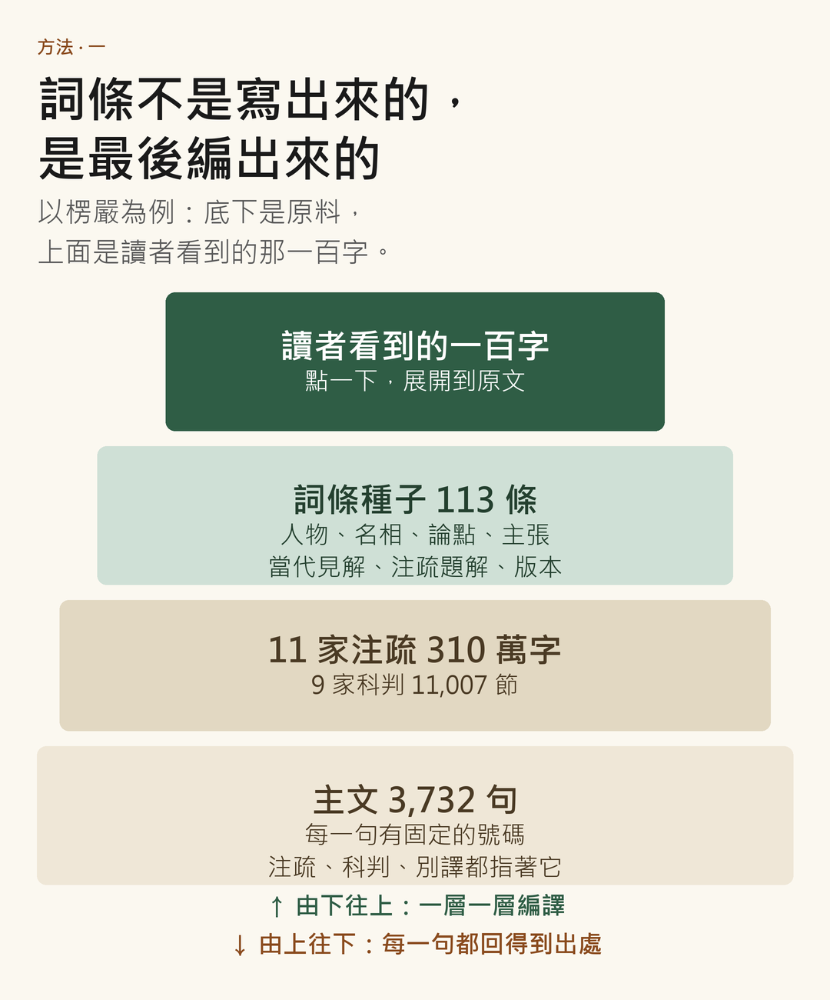
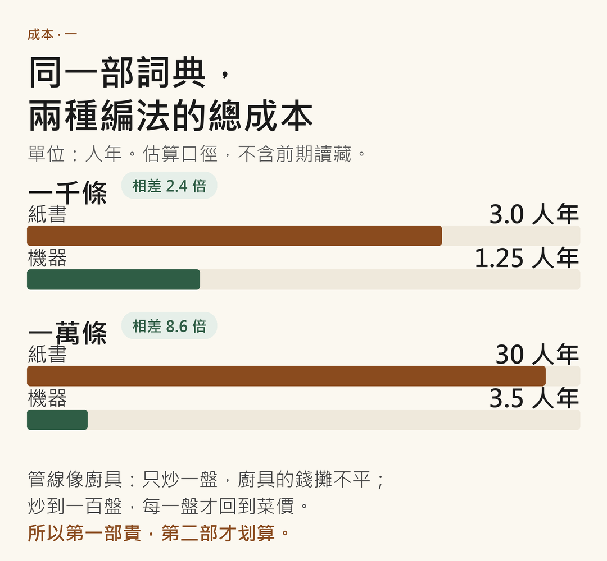
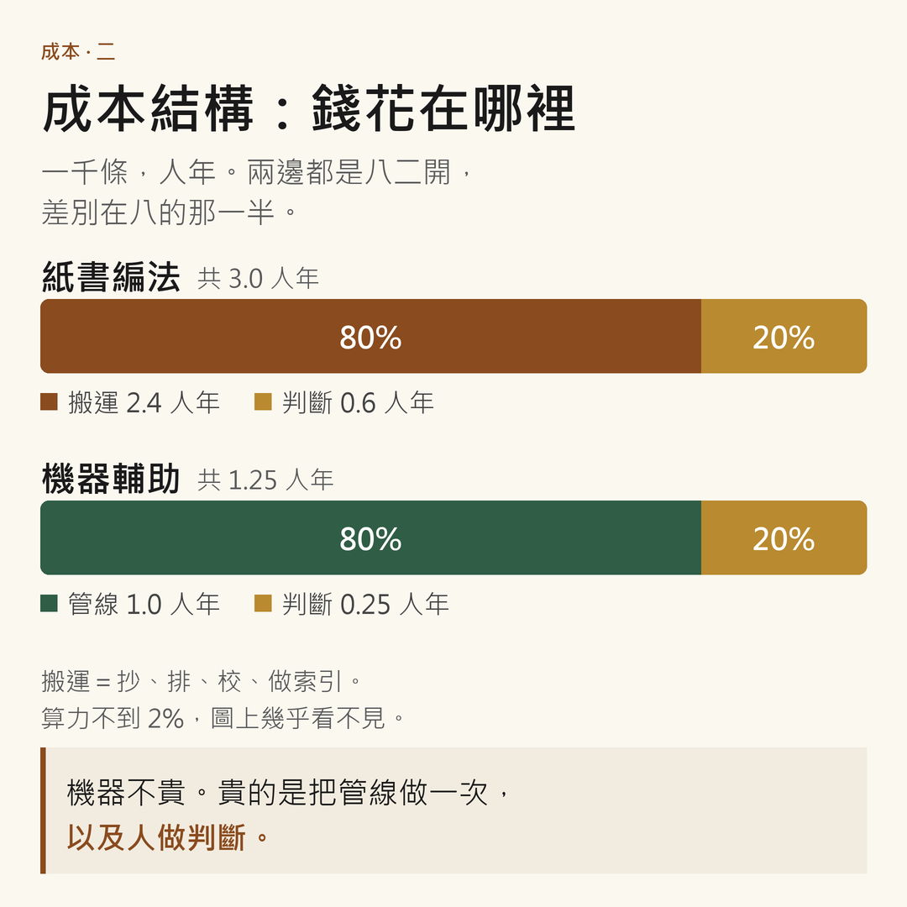
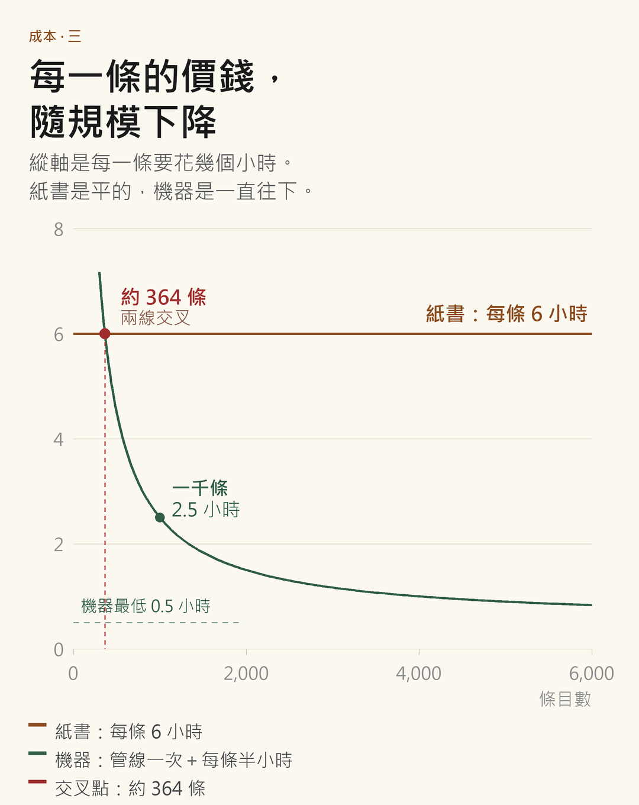

# 紙書與語料：專宗詞典編纂的兩個時代

> 副題：以《楞嚴詞典》為例

**摘要**

專宗詞典以一部經、一宗之學為範圍，價值在「界」而不在「義」。上一代以一詞一卡編纂，今天真正的做法是開一個 Word 檔，模擬紙書的版面，目標是出書；兩者的產物都是固體：詞條之間沒有機器可讀的關係。機器輔助編制先把材料備齊：每一句經文有固定編號，每一條說法記下出處；詞條是最後編譯出來的一百字。本文比較兩種方法在成本、可回答性、異說處理與修訂上的差異，並算一筆帳：一千條差二點四倍，一萬條差八倍多，交叉點在三百六十四條。實例是楞嚴 3,732 句、11 家注疏、113 條種子詞條。真正的差異不在速度，而在詞典的「種類」：從定義的集合，變成關係的介面。

**關鍵字**：專宗詞典、數位文獻學、詞典編纂、成本結構、楞嚴

---

## 一、一部詞典，一個老問題

我要編一部《楞嚴詞典》。它不是「佛學小辭典」的刪節本，是專宗詞典：以一部經、一宗之學為範圍，把一宗的名相、人物、注疏、論證、版本，編成一張可查的地圖。

專宗詞典在漢地不多，在日本卻是老傳統：天台、真言、淨土、禪，各宗都有自己的宗典；漢地這一類工作，多半由一兩位老法師帶著幾個學生做，做完放在寺院裡，流通不廣，更多的時候被「科會」「集註」代替，把經、科、注排在一起，讓讀者自己讀出來。

上一代的編法是卡片。一詞一卡，卡片上抄經文、抄注疏、寫出處；卡片放進抽屜，抽屜按部首或筆畫排。編者的桌子就是資料庫，編者的記憶就是索引。同一個詞在經、疏、鈔裡各出現一次，就要抄三次；抄到最後，編者要在腦中把它們合併成一條，而那一次合併不留痕跡。丁福保的《佛學大辭典》（1922）是這樣編的，望月信亨的《佛教大辭典》是這樣編的，《漢語大詞典》十二卷、約三十七萬條，動用了七百多萬張資料卡，也是這樣編的。

這幾部大辭典的關係，比一般人想的近。丁福保在序裡並不諱言，這部書大體以日本織田得能的《佛教大辭典》為藍本；《佛光大辭典》也大體以望月為依據。我們今天最常查的幾部大辭典，血緣上是一家：織田得能開了路，望月信亨把它擴大，丁福保把它帶進漢語世界，佛光山把它帶進現代寺院。

這不是貶低。在卡片的時代，大規模的「編譯＋增補」是唯一可行的路：與其從零抄三萬張卡，不如把別人抄好的三萬張卡接過來，再補上自己的。整個東亞的佛教辭典史，很大一部分是這種「接卡」的歷史。接卡的代價是：別人的錯，也一併接過來；別人的取捨，也變成你的取捨。

不過，這是上一代的事了。今天很少有人做卡片，今天編一部詞典，是開一個 Word 檔。所以這篇的比較對象不是卡片，是那個 Word 檔。

## 二、紙書的模擬：今天的實際做法

一）開檔、設樣式。標題一、標題二、詞條名用黑體、釋文用宋體、引文小一號；頁眉、頁腳、頁碼、分欄。整本書的結構，是「看起來像書」的結構。

二）排詞條。按筆畫或部首，一條一條排下去；參見寫成「見『如來藏』條」，是給人看的文字，不是給機器讀的連結。

三）引文與出處。腳註或夾註，出處寫到冊、頁、欄，讀者要自己去找那本書、翻到那一頁。

四）交排版。Word 轉排版檔，版面重跑一次；校樣三校；付印。電子書是 PDF，一樣是頁的容器。Word 是紙的草稿，PDF 是紙的照片；兩者都不是資料。

這套流程的產物，是一本紙書的模擬：每一個頁面都是最終印刷頁的預演。它為印刷而生，不為查詢而生。

代價有幾項，都不響。

一）結構是視覺的，不是語義的。標題一和標題二在機器眼裡只是字號與縮排；它不知道這一段是釋文、那一行是引文、這一句是參見。

二）關係是文字，不是連結。「見某某條」只有人看得懂；電腦檢索「如來藏」，不會沿著「見如來藏條」走到對面去。改一條，要人工把幾十處「見」找出來。

三）次序是線性的。紙書只能有一種排列；讀者想按出現位置查、按注家查，就要另做索引。索引是另一本書，常常做不完，最後只做詞頭索引。

四）修訂是重排。改一個字，版面會跑；跑版就要重新校對。所以一本紙書的修訂週期，大約等於一代人的工作壽命。

還有一項，最不容易看見：詞條與詞條之間，只有排版上的先後，沒有知識上的關係。同一家的說法散在幾十條裡，編者知道它們是一組，機器不知道；下一個編者要重新發現一次。

這不是誰懶。這是紙的物理限制：紙只能有一個次序，頁只能有一種大小，字只能排在一條線上。Word 檔是紙的模擬，它把紙的限制原封不動搬進電腦。

於是「出書」與「編詞典」被一個檔案綁在一起：出書是印刷工程，編詞典是知識工程；印刷工程有它的時間表，知識工程只好跟著它走。

出書不是錯的目標。錯的是把書當成資料的唯一形態；書是輸出，資料在下層。

## 三、先把材料備好

先說不是什麼：不是叫機器寫一千條詞條。那樣會得到一千條看起來很整齊、卻查不到出處的東西，比沒有更糟。

要做的，是把材料先備齊，讓「寫」變成最後一道工序。

一）每一句經文有一個固定的號碼，注疏、科判、別譯都指著同一組號碼；換一個版本，號碼不變。
二）每一條說法記下出處：哪一句、哪一家、哪一卷。沒有出處的句子，不進資料。
三）詞條是最後編譯出來的一百字；讀者點一下可以展開到原文，平時只看到那一百字。

機器只做三件事：把相關的句子找齊、把引文逐字對一遍、把材料排成初稿。判斷留給人：這一條算不算同一個詞、這一家是不是在反駁那一家、這個判教站不站得住。

它是那個笨奴隸：飛快，但完全不懂揣摩上意；切菜備料可以，火候與調味還是廚師。

## 四、楞嚴：一百一十三條的種子

楞嚴的底座是現成的。主文 3,732 句；11 家注疏全文，合計約 310 萬字：子璿 19.4 萬、戒環 12.7 萬、交光 35.1 萬、憨山 15.7 萬、蕅益 20.8 萬、錢謙益 31.6 萬、靈耀 32.4 萬、通理 41.0 萬、溥畹 25.6 萬、曾鳳儀 27.4 萬、圓瑛 48.6 萬；卍續藏另有 55 部注疏已盤點，其中全經注疏 28 部；9 家科判 11,007 個節點；6 字窗對齊，10 家注疏覆蓋 96–98% 的句子。

在這個底座上，詞典種子長出了 113 條，分八類：經中人物 19、名詞 29、論點 13、主張 5、當代見解 12、注疏題解 16、歷代人物 12、譯者版本 7。

一條長什麼樣：阿難，主文出現 458 次，七家注疏的命中數從 532 到 1,362；如來藏，主文 30 次，梵語、藏譯、英譯都有對照，每一家的命中次數另列。讀者查「如來藏」，看到的不只是一個解釋，是一個可以在經文裡跳來跳去的入口。

三個紙書很難做的決定，值得說一說。

一）把呂澂《楞嚴百偽》編成條目。「百偽」「假書」「真經說」都在當代見解類。詞典不替經辯護，也不替批評定案；它把批評的位置標出來，讓讀者知道這部經在現代學術裡受過什麼樣的審查。紙書通常不會這樣做，因為它只有一個聲音。

二）把「蒙鈔毁撤」收進來。乾隆三十八年，錢謙益《楞嚴經疏解蒙鈔》被撤出藏經。版本史就是詞典的一部分：一部注疏為什麼從藏裡消失，和它說了什麼一樣重要。

三）「經中人物」與「歷代人物」分開。一個是經裡的人，一個是解經的人；混在一起，讀者會以為子璿也參加了法會。分類不是圖書館的分類，是知識論的分類。

113 條還不是詞典，只是一副骨架，這一點要說清楚。但它已經證明一件事：詞條不必先「寫」出來，可以先「長」出來，最後才「編」出來。

## 五、楞嚴的三重難處

楞嚴的難，不在經文長，在材料散。

一）注疏群大而散。卍續藏五十五部，全經注疏二十八部；已收十一家，三百一十萬字。同一個詞，子璿講、交光講、蕅益講、圓瑛也講；四個人用的是同一套名相，判斷卻不同。詞典要處理的不是「一詞一義」，是「一家一說」。

二）咒語是另一種詞典。楞嚴咒一百四十三句梵文、四百五十四個詞形、四百四十六個詞元，詞級對齊只有四十二列是確定的。咒語是音譯，不是義譯；同一個音可以有幾種寫法，同一種寫法可以指幾個音。它與義理詞不能混排，也不能用同一套解釋體例。

三）疑偽與版本。呂澂的《楞嚴百偽》列了一百條疑點；乾隆年間《蒙鈔》被撤；同一部圓瑛講義，三個電子本只差四百四十五字（百分之零點零九），差別在科文標記，不在文字。這三件事看起來不相干，其實是同一件事：這部經的地位不是給定的，是歷史裡談出來的。詞典如果不收這一層，它就只是一本解釋書，不是一部專宗詞典。

## 六、成本：啟動成本與攤平

先講規模。第一部先做一千條，算一筆帳。

一千條：紙書每條六小時，六千小時，三人年（一年兩千小時計）；機器每條半小時審核，五百小時，加管線與校對工具一人年，合計一點二五人年。相差二點四倍。

固定成本就是啟動成本。好比你要炒一盤菜，鍋、鏟、砧板、灶先要備齊；只炒一盤，廚具的錢攤不平；炒到一百盤，每一盤才回到菜的價錢。管線就是那套廚具。

錢花在哪裡：紙書三人年裡，二點四是搬運（抄、排、校、做索引），零點六是判斷；機器一點二五裡，一點零是管線（只建一次），零點二五是判斷；算力不到百分之二，圖上幾乎看不見。所以錢不是花在機器上，是花在「把廚具備齊」與「人做判斷」。

什麼時候攤平？約三百六十四條，兩條線交叉；此後每一條都比紙書便宜。一千條是二點五小時一條，紙書是六小時。

一萬條：紙書三十人年，機器三點五人年，八倍多。

第二部詞典：廚具已經有了，換一道菜，不必再買一次鍋。工程不必重做，只剩審核，約零點三五年。

所以第一部貴，第二部便宜。這也是為什麼要先把楞嚴做完：它是第一部，也是管線的驗收。

## 七、巨大的差異，在四個「能不能」

先破一個誤會：差異不只是快慢。快是結果，不是原因。原因是詞典的原子換了：紙書的原子是一個詞條，新的原子是一句話加一個主張。

| | 紙書（Word／PDF） | 機器輔助 |
|---|---|---|
| 資料單位 | 一個詞條 | 一句話＋一個主張 |
| 結構 | 字號、縮排、分欄 | 句子編號、出處 |
| 權威來源 | 編者的閱讀 | 可回查的出處 |
| 檢索 | 索引、人腦 | 一句話查得到 |
| 異說 | 折衷成一條 | 並列、標版本 |
| 修訂 | 改版，十年 | 改資料，分鐘 |
| 完成 | 出版即凍結 | 版本快照，可生長 |
| 瓶頸 | 寫、排、校 | 判斷、驗收 |

換了原子，詞典能回答的問題就換了一組。我把差異收成四個「能不能」。

**一）能不能知道「沒有什麼」。** 紙書只能記錄「有」；「沒有」不在稿子裡。新底座能回答：這個詞在主文出現幾次（可以是零次）；楞嚴十家注疏覆蓋 96–98% 的句子，剩下的 2–4% 是哪幾句；哪一家科判在這一卷完全沒有節點。對專宗詞典，這是判斷「經證」與「宗義」的關鍵：賢首十門是宗義，經文裡沒有這四個字；如果詞典不知道經文有沒有，它就分不清這兩件事。

**二）能不能回答「誰說的、在哪一句」。** 一條「耳根圓通」，紙書給你六十字；新的詞典給你六十字，加三行：經文哪幾句、哪幾家注、哪一家說法不同。讀者可以不信你，但可以查你。這不是禮貌，是詞典的定義：詞典的權威，來自它可以被追問。

**三）能不能讓異說並存。** 紙書為了「一條定義」，必須在異說之間折衷；折衷就是一種判教，編者悄悄地做了宗派判斷。交光把「捨識用根」標為一經綱宗，別家未必同意；詞典不能替他裁決，只能並列、標版本、不替讀者下結論。折衷是把三種說法煮成一鍋湯；並列是把三盤菜一起端上來，吃哪一盤由讀者決定。這是四個差異裡最不容易被察覺的一項：紙書的「簡明」，是以抹平差異為代價的。

**四）能不能改。** 紙書一出版就凍結，修訂等於重排，重排等於再花十年。新的詞條是資料，改一處全站同步，可以標「本條待考」，可以出第二版。詞典從碑變成帳。

但這裡有一個反面的巨大差異，要一起說：**出錯的速度也一樣快。** 錯的規則會跑一萬次，而且跑得很整齊。所以「沒有出處，就不進資料」這條規矩不是裝飾；沒有版本快照、沒有抽樣驗收、沒有「這一版定稿」的儀式，新詞典只會更快地變成一本很整齊的錯書。

還有一項，比這四個都根本：編纂者的角色。紙書的編纂，八成的工時在搬運（抄、排、校、做索引），兩成在判斷；新的方法把搬運壓到接近零，判斷變成十成。這不是人失業，是判斷的門檻提高了：編者不能再躲在「我讀過很多書」後面，他要為每一條判斷負責，而且要說得出這一條根據哪一句。

## 八、專宗詞典為什麼更需要這一套

普通詞典求「通」，專宗詞典求「專」。專的知識是「有邊界的系統」：楞嚴的七處徵心、十番顯見是一個論證鏈，不是一串名詞；二十五圓通不是二十五個並列的答案，是先列出二十五種入門，再由文殊揀選耳根，那是一段有結論的比較。

所以專宗詞典更像本體論，而不是詞表。紙書的「參見」是手工的單向箭頭；新的可以真的建圖，因為引文關係本來就在資料裡：誰引誰、誰註誰、誰反駁誰，都是可以抽出來的邊。

而且專宗詞典必須分開四層證據：

一）經文原語：這部經有沒有這個詞。
二）注疏用語：子璿、交光、蕅益怎麼用這個詞。
三）宗義成立：賢首十門、天台五重玄義，宗派後來的系統化。
四）現代研究：呂澂的批評、學界的考證、版本的發現。

紙書把四層壓成一句話；新的把它們分開，讓讀者看見「這一句是經說，那一句是宗義，那一句是民國學者的懷疑」。這就是專宗詞典與普通詞典的分野，也是為什麼專宗詞典比普通詞典更適合新方法：它的價值在關係與界限，不在定義。

舉兩個例子。

如來藏。經文說「如來藏妙真如性」；注疏多以「本覺」釋之；呂澂說這部經是偽。三個聲音都要在，而且要能分開；分不開，讀者就只能在「信仰」與「學術」之間選一邊，而詞典的責任是不讓他被迫選。

捨識用根。交光把它標為一經綱宗；後來的注家有的從、有的不從。詞典不是裁判，它把兩邊的位置排好，讓讀者自己走進去。

## 九、限制與危險

一）機器會編，它最擅長的是「看起來像」：像引文、像出處、像梵文。對策不是相信它，是「無引用不成立」：引文逐字比對，對不到就退章級、就留空、標「待考」。楞嚴有五家科判「位置無法逐條錨定，只能等比推」，我們就把它們放進剔除清單，不假裝它們是實錨。寧可空，不要硬塞。

二）機器會平均化。它讀過的文本比任何編者多，傾向卻是把稜角磨平，給一個「一般佛學」的說法。專宗詞典最怕這個：楞嚴之所以是楞嚴，正在那些不與他宗妥協的地方。

三）判教不能統計。天台四教、賢首五教，是判斷不是頻率；機器可以列出「賢首宗判此經為圓教」，不能判斷「這個判釋對不對」。這一層永遠是人的。

四）授權與版本。中華電子佛典協會的文本有授權條件；近代著作還在保護期內（圓瑛 1953 年圓寂）；掃描本的光學辨識錯字要逐頁校。詞典要活得久，這些帳要先算清楚。

五）永遠的未定稿。沒有凍結，就沒有權威。所以要有版本快照、要有定稿的儀式，也要敢在詞條上寫「本條待考」。

六）讀者的信任。詞典不是搜尋引擎；搜尋引擎可以給你十個答案，詞典只能給你一個，而且要為那一個負責。新的詞典若要可信，它必須比紙書更敢說「我不知道」。

還有一條，是方法本身的限制：這套東西只對「有語料」的題目有效。沒有電子文本、沒有版本、沒有注疏的經，機器幫不上忙；它只能幫你更快地發現「這裡沒有材料」。所以它不取代讀藏，它讓讀藏的人知道該讀哪裡。

## 十、為誰而編

三種讀者：初學要一句話；行者要修法與出處；研究者要異說與版本。紙書只能滿足第一種，勉強第二種；新的可以三種都給，代價是介面要會收放：點一下展開一層，再點再深，不想看的人永遠只看到那一百字。

專宗詞典是「宗派知識的公共介面」：把一家之言變成可查、可引、可爭論的公共物件。從前它是一個宗派的內部教材，現在它可以是一個宗派對外的介面。這對教界是好事：能被查，才談得上被理解。

同一份資料，可以排成紙書、出電子書、開網站。紙書還是要出；差別是，出書之前，錯字與出處已經被查過一遍，不必等校樣才發現。

這裡有一條分寸，作者說過：不是人向機器妥協，也不是機器向人妥協，而是各退一步。機器退一步，不假裝懂宗義，不替讀者下判教，不生成沒有出處的句子；人退一步，不再堅持每一條都自己從頭讀過，接受「機器先讀一遍，我只讀它標出來的地方」。具體的載體是中文標記：資料裡寫 `<經>`、`<注>`、`<聯>`、`<術>`，編者一眼看得懂，機器也讀得懂，不必先學一套外文縮寫才能讀自己的資料。介面的效率，就是從這一步開始的。

老編者的 Word 檔還在，樣式跑了、腳註亂了。新的抽屜是硬碟裡的一個資料夾，裡面是句子表、切點表、詞條表。載體換了，動作沒換：還是一張一張地看，一句一句地對。

差別是，這一代人的抽屜，下一代人可以直接打開。

---

> 本文的數字取自楞嚴對讀站、金剛經合注與跨專案規範區的估算口徑；估算不是報價，換題目要重算。2026 年 11 月。
